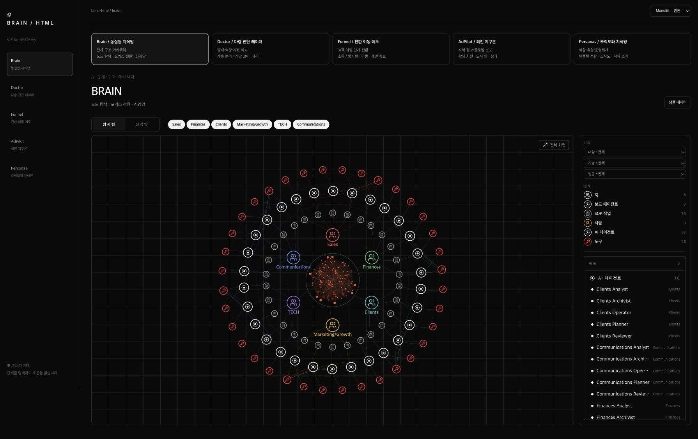

# Brain HTML

**내용을 넣으면 인터랙티브 그래프 HTML로 만들어 주는 에이전트 스킬. 다섯 가지 시각화를 독립 HTML 한 파일로 만든다.**

동심원 지식망, 다층 진단 레이더, 단계별 이동 궤도, 관성 회전 지구본, 페르소나 조직도. 정지된 그림이 아니라 브라우저에서 노드 포커스·필터·회전·레이어 전환이 실제로 작동한다.

[English](README.md) · [스타일 갤러리](skills/brain-html/assets/examples/style-gallery.html) (내려받아 로컬에서 열기)



## 다섯 모드

| 보기 | 그래프·모션 | 적합한 요청 |
|---|---|---|
| **1 · Brain** | 동심원 노드, 중앙 지식 코어, 포커스 전환, 신경망 | 개념 관계, 시스템 구조, 프로젝트·지식 탐색 |
| **2 · Doctor** | 다층 레이더, 진단 코어, 미터, 계단형 추이 | 상태 점검, 역량·성과 비교, 커버리지 |
| **3 · Funnel** | 단계별 이동 궤도, 흐름/방사형 전환, 개별 노드 정보 | 고객 여정, 전환, 진행 단계, 파이프라인 |
| **4 · AdPilot** | 관성 회전 지구본, 도시 핀, 붉은 광원, 성과 매트릭스 | 지역·글로벌 분포, 광고 캠페인, 도달 범위 |
| **5 · Personas** | 역할별 조직도, 페르소나 전환, 색상별 지식망 | 팀·역할·사용자 유형, 운영체계 비교 |

모드를 고르지 않으면 요청에서 알아내려는 것을 기준으로 자동 선택한다. 관계는 Brain, 여러 축의 상태는 Doctor, 순차 진행은 Funnel, 실제 지리 좌표는 AdPilot, 역할 구성은 Personas. 보조 모드는 필요할 때만 더하고, 지리 정보가 없으면 가짜 도시를 만들지 않는다.

## 설치

```sh
npx skills add dearyour/brain-html --skill brain-html --global --copy --yes
```

오픈소스 [Skills CLI](https://github.com/vercel-labs/skills)를 사용한다. 특정 에이전트만 지정하려면 `--agent codex` 또는 `--agent claude-code`를 붙인다. 설치 후 새 세션을 시작한다.

Codex 수동 설치(기존 폴더를 덮어쓰지 않고 모든 파일의 SHA-256을 검증):

```sh
git clone https://github.com/dearyour/brain-html.git
python3 brain-html/skills/brain-html/scripts/install.py
```

Claude Code는 `skills/brain-html` 폴더를 `~/.claude/skills/`에 복사한다.

사용 예:

> $brain-html 우리 서비스 기능 영역, 담당, 의존 관계를 인터랙티브 그래프로 만들어줘.

## 에이전트 없이 생성

런타임이 미리 빌드되어 있어 Python 표준 라이브러리만 있으면 된다. Node, CDN, 서버가 필요 없다.

```sh
cd skills/brain-html
python3 scripts/render.py --mode brain --data content.json --output out/index.html
python3 scripts/render.py --mode brain --sections doctor --data content.json --output out/overview.html
python3 scripts/render.py --showcase --output out/styles.html
```

- `--data`가 없으면 **샘플 데이터**로 명시된다. `--data`를 주면 샘플을 섞지 않는다.
- 테마 `--theme mono|dark|midnight|ember|mono-light`, 제목 `--title`.
- 기존 출력 파일은 덮어쓰지 않는다.
- 모드별 데이터 형식: [데이터 계약](skills/brain-html/references/data-contract.md).

`python3 scripts/verify.py`로 다섯 모드 생성, 사용자 데이터 격리, 스크립트 이스케이프, 덮어쓰기 방지, 설치 무결성을 빠르게 확인한다.

## 엔진 수정

수정 가능한 소스는 `skills/brain-html/assets/runtime/`(React 18, d3-force, Tailwind 3, esbuild)에 있다. 작업 폴더로 복사한 뒤 수정하고 `scripts/build.mjs`로 다시 빌드한다. [소스 재사용·빌드](skills/brain-html/references/reuse.md)와 카메라 회귀 테스트가 있는 [트리 화면 맞춤](skills/brain-html/references/tree-framing.md)을 참고한다.

## 접근성과 범위

- CSS, SVG, `requestAnimationFrame` 모션 모두 `prefers-reduced-motion`을 따른다.
- 모든 그래프 노드는 이름 있는 버튼·목록으로도 탐색할 수 있고, Canvas 지구본에는 텍스트 지역 요약이 있다.
- 내장 어댑터는 **네트워크를 호출하지 않는다**. 원본 앱의 업무 기능(에이전트 실행, 광고 집행, 문서 저장, 실시간 데이터 API)은 의도적으로 포함하지 않았다.

## 출처와 라이선스

다섯 시각화 엔진은 [dearyour/command-center](https://github.com/dearyour/command-center)의 `f367aff` 커밋에서 추출했다. 파일별 SHA-256은 [source-manifest.json](skills/brain-html/references/source-manifest.json)에 있다. 서버 데이터 생산자는 독립 어댑터로, 원본 인물명·브랜딩은 중립 도형으로 바꿨다.

[MIT](LICENSE). 번들 의존성(React, d3, lucide, zod) 고지: [dependencies.txt](skills/brain-html/assets/licenses/dependencies.txt).
