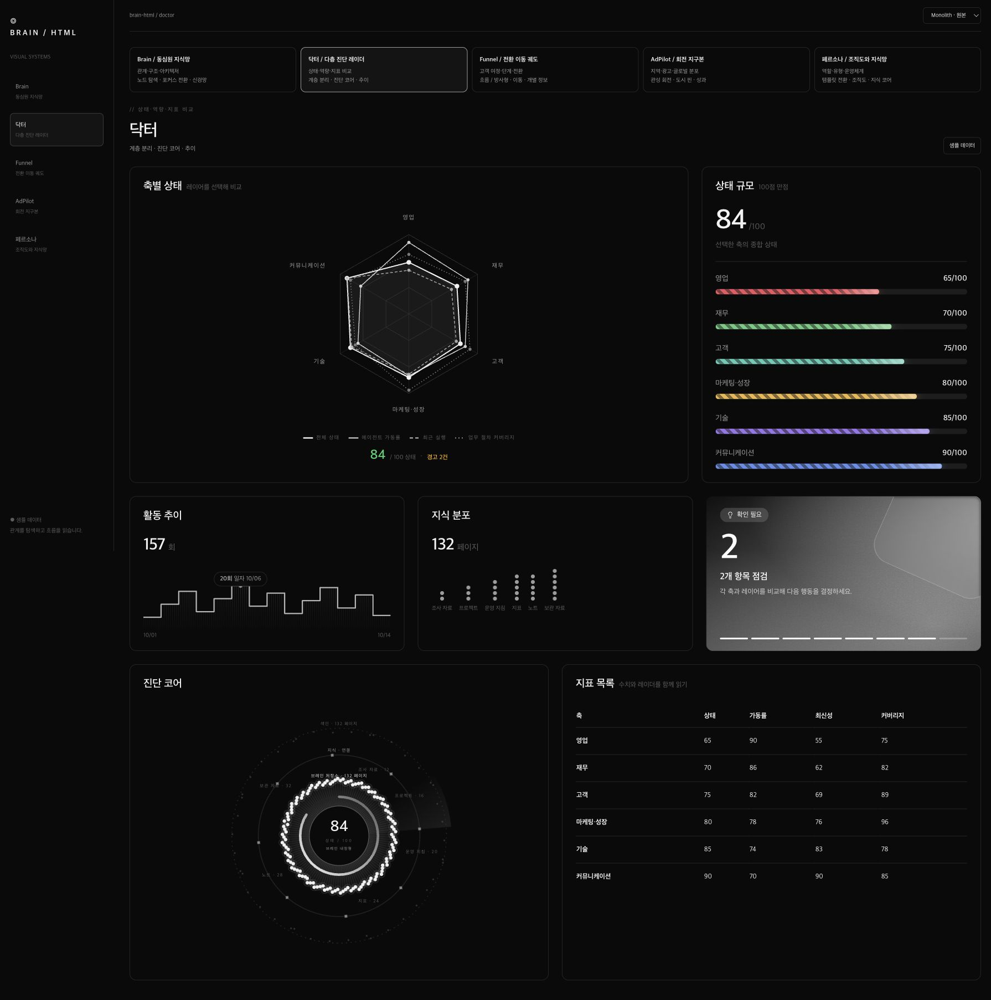
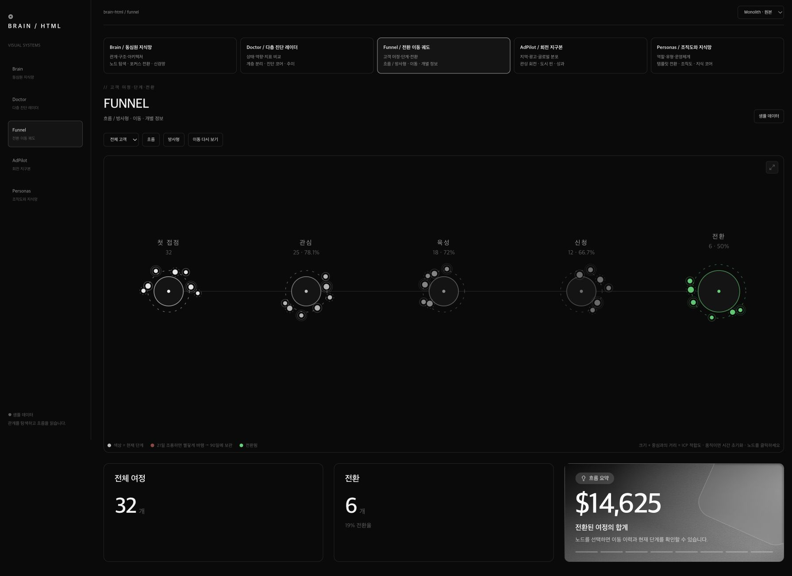
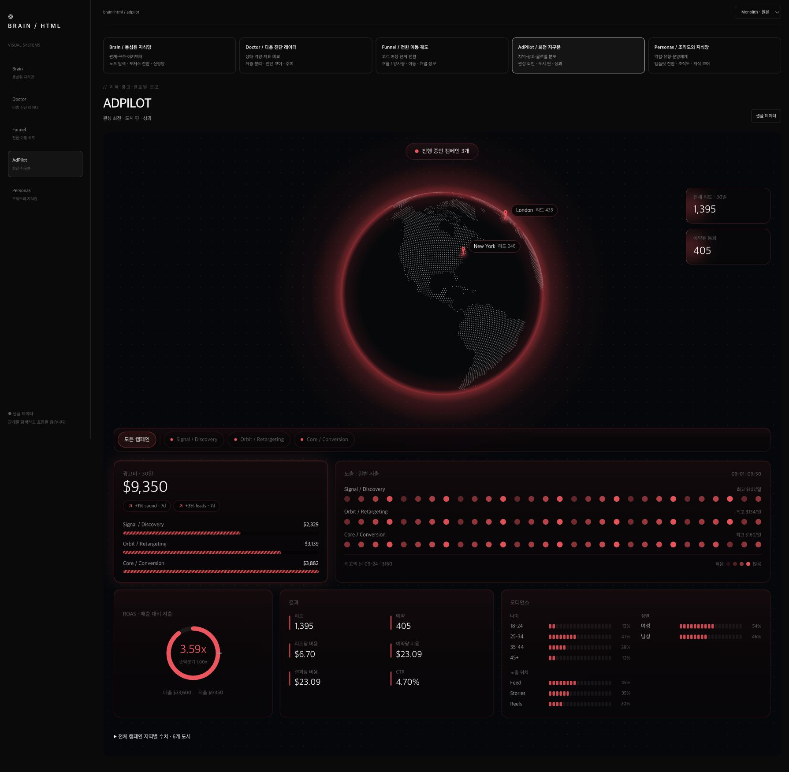
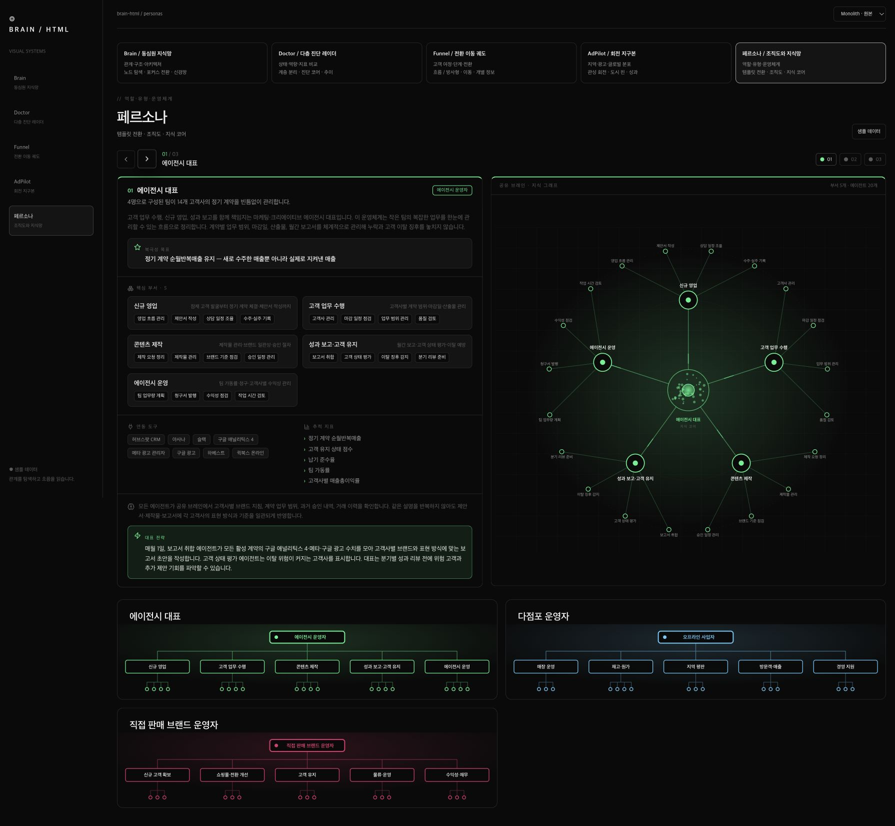

# 다섯 스타일 실제 미리보기

같은 독립 HTML 갤러리에서 캡처했다. 샘플 데이터이며 캡처 시점에는 모션 감소 모드를 사용했다. 움직임과 클릭은 [실행 갤러리](../assets/examples/style-gallery.html)에서 확인한다.

## 1 · Brain — 관계와 구조

## 2 · Doctor — 다층 진단과 비교

## 3 · Funnel — 여정과 전환

## 4 · AdPilot — 지리와 광고

## 5 · Personas — 역할별 운영체계

